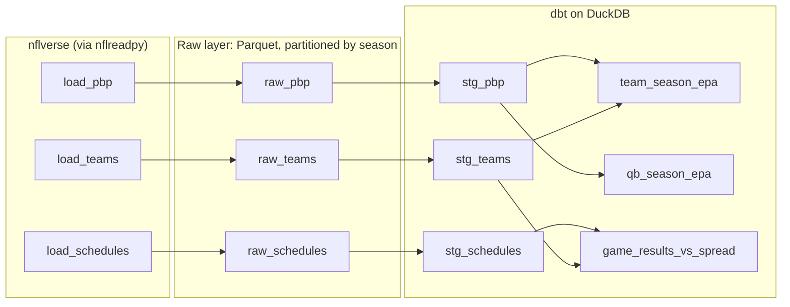

# nfl-dagster

An end-to-end data pipeline that pulls NFL play-by-play data from [nflverse](https://github.com/nflverse), lands it as Parquet, models it with [dbt](https://www.getdbt.com/) on [DuckDB](https://duckdb.org/), and orchestrates all of it with [Dagster](https://dagster.io/).

This is a **learning project**. The pipeline is real and runs end to end, but the main goal is to work through Dagster's core ideas on a dataset that's fun to explore. Each Dagster feature used here is listed in [Dagster concepts covered](#dagster-concepts-covered), along with where to find it in the code and how to see it in the UI.

> **Status:** work in progress. See the [roadmap](#roadmap) for what's built and what's next.

---

## Table of contents

- [What it does](#what-it-does)
- [Architecture](#architecture)
- [Tech stack](#tech-stack)
- [Project structure](#project-structure)
- [Getting started](#getting-started)
- [Running the pipeline](#running-the-pipeline)
- [Data model](#data-model)
- [Dagster concepts covered](#dagster-concepts-covered)
- [Hands-on exercises](#hands-on-exercises)
- [Design decisions](#design-decisions)
- [Troubleshooting](#troubleshooting)
- [Roadmap](#roadmap)
- [Data attribution](#data-attribution)
- [License](#license)

---

## What it does

1. **Extract:** downloads play-by-play, schedules, and team data for the 2016 through current NFL seasons using [`nflreadpy`](https://github.com/nflverse/nflreadpy).
2. **Land:** writes each season to its own Parquet file under `data/raw/`.
3. **Validate:** runs Dagster asset checks against each season, such as "no duplicate plays" and "scores are either both present or both missing."
4. **Transform:** builds staging and mart models in dbt on DuckDB. The marts answer questions like:
   - Which offenses and defenses were most efficient by EPA per play each season?
   - Which quarterbacks generated the most value per dropback?
5. **Orchestrate:** refreshes the current season on a schedule twice a week during the season. Once new raw data lands, the dbt models rebuild automatically.

---

## Architecture



Dagster sees all of this as one **asset graph**. The Python assets (`raw_*`) and the dbt models show up as connected nodes, so lineage, freshness, and check results can be followed from the source download all the way to the marts.

---

## Tech stack

| Tool | Role |
| --- | --- |
| [Dagster](https://dagster.io/) | Orchestration: assets, partitions, checks, schedules, automation, UI |
| [nflreadpy](https://github.com/nflverse/nflreadpy) | Python client for nflverse data (returns Polars DataFrames) |
| [Polars](https://pola.rs/) | In-memory DataFrames for the extract step |
| [Parquet](https://parquet.apache.org/) | Raw storage format, one file per season |
| [DuckDB](https://duckdb.org/) | Local analytical database that dbt builds into |
| [dbt](https://www.getdbt.com/) + [dbt-duckdb](https://github.com/duckdb/dbt-duckdb) | SQL transformations and tests |
| [dagster-dbt](https://docs.dagster.io/integrations/libraries/dbt) | Loads dbt models into Dagster as assets |

Everything runs locally. No cloud accounts or API keys are needed.

---

## Project structure

```
nfl-dagster/
├── pyproject.toml              # Package metadata, dependencies, Dagster module config
├── src/nfl_dagster/
│   ├── definitions.py          # Entry point: the Dagster Definitions object
│   ├── partitions.py           # Season partitions (2016 → current season)
│   ├── resources.py            # DuckDB + dbt resources, project paths
│   └── assets/
│       ├── raw.py              # raw_pbp, raw_schedules, raw_teams + asset checks
│       └── dbt.py              # dbt models loaded as Dagster assets
├── dbt_project/
│   ├── dbt_project.yml
│   ├── profiles.yml            # DuckDB connection (data/nfl.duckdb)
│   └── models/
│       ├── sources.yml         # Raw Parquet files declared as dbt sources
│       ├── staging/            # stg_pbp, stg_schedules, stg_teams
│       └── marts/              # team_season_epa, qb_season_epa, ...
├── tests/
│   └── test_definitions.py     # Checks that the Dagster definitions load
└── data/                       # Created at runtime; not committed
    ├── raw/
    │   ├── pbp/season=YYYY.parquet
    │   ├── schedules/season=YYYY.parquet
    │   └── teams.parquet
    └── nfl.duckdb
```

---

## Getting started

### Prerequisites

- Python **3.10 to 3.13** (developed on 3.12)
- `git`
- About 1 GB of free disk space if you load every season

### Install

```bash
git clone https://github.com/JL037/nfl-dagster.git
cd nfl-dagster
python3 -m venv .venv
source .venv/bin/activate
pip install -e ".[dev]"
```

### Set a Dagster home (recommended)

Without `DAGSTER_HOME`, `dagster dev` keeps run history in a temporary folder that gets deleted when it stops. To keep runs, materializations, and check results between sessions:

```bash
mkdir -p .dagster_home
export DAGSTER_HOME="$PWD/.dagster_home"
```

`.dagster_home/` is gitignored.

### Check that everything loads

```bash
dagster definitions validate
```

---

## Running the pipeline

### Start the UI

```bash
dagster dev
```

Then open <http://localhost:3000>.

### First run (suggested order)

1. **Materialize `raw_teams`.** It's unpartitioned, so it's a single click.
2. **Materialize one season of `raw_pbp` and `raw_schedules`**, for example `2025`. Select the asset, click **Materialize**, and pick the partition.
3. **Look at the result.** Open the asset and check the metadata: row count, column count, file path, and a preview table.
4. **Run the dbt models.** Select the dbt assets and materialize them.
5. **Backfill the remaining seasons.** Select `raw_pbp` and `raw_schedules`, click **Materialize**, choose all partitions, and launch a backfill.

### Query the results

The marts live in `data/nfl.duckdb`. You can query them with the DuckDB CLI or from Python:

```python
import duckdb

con = duckdb.connect("data/nfl.duckdb", read_only=True)
con.sql("""
    select season, team, off_epa_per_play, def_epa_per_play
    from team_season_epa
    where season = 2025
    order by off_epa_per_play desc
    limit 10
""").show()
```

Opening the file with `read_only=True` lets you query while Dagster is running (see [Troubleshooting](#troubleshooting)).

### Run dbt by hand (optional)

dbt paths are relative to the `dbt_project/` folder, so run it from there:

```bash
cd dbt_project
dbt build --profiles-dir .
```

### Run tests

```bash
pytest
```

---

## Data model

### Raw (Python assets, Parquet)

| Asset | Partitioned | Source | Notes |
| --- | --- | --- | --- |
| `raw_pbp` | By season | `nflreadpy.load_pbp` | About 48k plays and 372 columns per season |
| `raw_schedules` | By season | `nflreadpy.load_schedules` | One row per game, including betting lines |
| `raw_teams` | No | `nflreadpy.load_teams` | Team names, conferences, divisions, colors |

### Staging (dbt views)

| Model | Description |
| --- | --- |
| `stg_pbp` | Real plays only (`play_type in ('pass', 'run')`), trimmed to the columns used downstream (EPA, success, win probability, players, and `qb_dropback`) |
| `stg_schedules` | Cleaned game results and betting lines |
| `stg_teams` | Team lookup |

### Marts (dbt tables)

| Model | Grain | Key metrics |
| --- | --- | --- |
| `team_season_epa` | team × season | Offensive and defensive EPA per play, success rate |
| `qb_season_epa` | passer × season | Dropbacks, EPA per dropback (filtered to a minimum number of dropbacks) |
| `game_results_vs_spread` *(planned)* | game | Final margin compared with the closing spread |

**EPA (Expected Points Added)** measures how much a play changed a team's expected points. It's the standard way to measure efficiency in NFL analytics. **Success rate** is the share of plays with EPA above zero.

---

## Dagster concepts covered

| Concept | Where it's used | How to see it |
| --- | --- | --- |
| **Software-defined assets** | `assets/raw.py` | Asset graph in the UI |
| **Partitions** (static, by season) | `partitions.py`, `raw_pbp`, `raw_schedules` | The partition status bar on each asset |
| **Backfills** | Launched from the UI | **Overview → Backfills** |
| **Materialization metadata** | `MaterializeResult` in `raw.py` | Row counts and preview tables on the asset page |
| **Asset checks** (partitioned and blocking) | `raw_pbp_unique_plays`, `raw_schedules_scores_present` | The **Checks** tab on each asset |
| **Resources** | `resources.py` (`DuckDBResource`, `DbtCliResource`) | Passed into assets and checks |
| **dbt integration** | `assets/dbt.py`, `sources.yml` | dbt models appear as assets, linked to `raw_*` |
| **dbt tests as asset checks** | `unique` / `not_null` tests | The **Checks** tab on dbt assets |
| **Jobs** | `current_season_refresh` | **Jobs** in the left nav |
| **Schedules** | Tuesday and Friday at 10:00 Pacific | **Automation → Schedules** |
| **Declarative automation** | `AutomationCondition.eager()` on dbt models | The **Automation** tab on each dbt asset |

---

## Hands-on exercises

These are small experiments for building intuition. Each one breaks something or changes something on purpose, then uses the UI to see how Dagster reacts.

1. **Watch automation refuse to run.** Load only the 2025 season, turn on the automation sensor, and open a dbt asset's **Automation** tab. `eager()` won't run while any upstream partition is missing, and the evaluation view shows `any_deps_missing` as the reason. Backfill the remaining seasons and watch the dbt models run on their own.
2. **Make a check fail.** Temporarily duplicate a row in `raw_pbp` before writing. The blocking uniqueness check fails and the downstream dbt models don't run.
3. **Re-run a check without re-materializing.** Run only an asset check from the UI and notice that the asset itself isn't rebuilt.
4. **Trigger the schedule early.** In **Automation → Schedules**, open `current_season_refresh` and use **Test schedule** to see the run request it would create.
5. **Compare backfill strategies.** Launch the same backfill with different concurrency settings and compare the runs view.

---

## Design decisions

**Parquet files for the raw layer, not DuckDB tables.** The play-by-play schema changes between seasons. Some columns are entirely null in older years, which gives them a different type. Inserting season after season into one DuckDB table would fail on those mismatches. Separate Parquet files per season, read with `read_parquet(..., union_by_name = true)`, absorb the differences.

**One writer for the DuckDB file.** DuckDB lets only one process write to a database file at a time. dbt is the only thing that writes to `data/nfl.duckdb`. Asset checks read the Parquet files through their own temporary in-memory DuckDB connection, so they never compete with dbt for the lock.

**Season partitions are worked out when the code loads.** `partitions.py` builds the partition list from 2016 up to `nflreadpy.get_current_season()`, so a new season appears automatically each year without a code change.

**The partitioned job leaves out unpartitioned assets.** A Dagster asset job can't mix assets that have different partition definitions. `current_season_refresh` covers only `raw_pbp` and `raw_schedules`. The dbt models are triggered by declarative automation instead.

**Data is not committed.** Everything under `data/` is created at runtime and gitignored. Anyone can rebuild it from nflverse.

---

## Troubleshooting

**`IO Error: Could not set lock on file "data/nfl.duckdb"`**
Another process has the database open for writing. Usually that's a dbt run in progress, or a Python session or DuckDB CLI holding the file open. Close it, or open the file with `read_only=True`.

**dbt models never run automatically**
Check that the automation sensor is turned on (**Automation → Sensors**). Then open the dbt asset's **Automation** tab to see which condition is blocking it. The most common cause is upstream seasons that haven't been materialized yet (`any_deps_missing`).

**`dbt` can't find the Parquet files when run by hand**
Run dbt from inside `dbt_project/`. The source paths are relative to that folder.

**Run history disappears after restarting `dagster dev`**
Set `DAGSTER_HOME` as described in [Getting started](#set-a-dagster-home-recommended).

---

## Roadmap

**Core pipeline**

- [x] Project scaffold, season partitions, resources
- [ ] Raw assets: `raw_pbp`, `raw_schedules`, `raw_teams`
- [ ] Asset checks on raw data
- [ ] dbt project: sources, staging, marts, tests
- [ ] dbt assets in Dagster with declarative automation
- [ ] Current-season job and schedule
- [ ] Definitions test

**Learning extensions**

- [ ] Weekly partitions within a season (`MultiPartitionsDefinition`: season × week)
- [ ] A sensor that polls nflverse release timestamps and runs only when the data has changed
- [ ] More sources: player stats, Next Gen Stats, injuries
- [ ] A small dashboard (Streamlit or Evidence) on top of the marts

---

## Data attribution

NFL data is provided by [nflverse](https://github.com/nflverse) and accessed through [nflreadpy](https://github.com/nflverse/nflreadpy). Thanks to the nflverse maintainers and contributors for making this data openly available.

Most nflverse datasets are released under [CC-BY 4.0](https://creativecommons.org/licenses/by/4.0/), and some have different terms. Check the [nflverse data documentation](https://github.com/nflverse/nflverse-data) for the license of each dataset. This repository does not redistribute any data; it downloads it at runtime.

This project is not affiliated with or endorsed by the NFL or nflverse.

---

## License

The code in this repository is licensed under the terms in [LICENSE](LICENSE).
