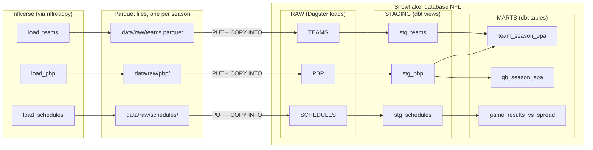

# nfl-dagster

An end-to-end data pipeline that pulls NFL play-by-play data from [nflverse](https://github.com/nflverse), lands it as Parquet, loads it into [Snowflake](https://www.snowflake.com/), models it with [dbt](https://www.getdbt.com/), and orchestrates all of it with [Dagster](https://dagster.io/).

This is a **learning project**. The pipeline is real and runs end to end, but the main goal is to work through Dagster's core ideas on a dataset that's fun to explore. Each Dagster feature used here is listed in [Dagster concepts covered](#dagster-concepts-covered), along with where to find it in the code and how to see it in the UI.

> **Status:** the core pipeline is complete: scheduled ingestion, validated loads, checks, dbt models, and declarative automation on Snowflake, with separate dev and prod environments and CI on every pull request. Learning extensions are listed in the [roadmap](#roadmap).
>
> The project started on DuckDB and was migrated to Snowflake, with the results verified against the DuckDB build. The DuckDB version is in the git history up to commit `23b287c`.

---

## Table of contents

- [What it does](#what-it-does)
- [Architecture](#architecture)
- [Tech stack](#tech-stack)
- [Project structure](#project-structure)
- [Getting started](#getting-started)
- [Environments and workflow](#environments-and-workflow)
- [Running the pipeline](#running-the-pipeline)
- [Data model](#data-model)
- [Sample results](#sample-results)
- [Dagster concepts covered](#dagster-concepts-covered)
- [Hands-on exercises](#hands-on-exercises)
- [Design decisions](#design-decisions)
- [Cost](#cost)
- [Troubleshooting](#troubleshooting)
- [Roadmap](#roadmap)
- [Data attribution](#data-attribution)
- [License](#license)

---

## What it does

1. **Extract:** downloads play-by-play, schedules, and team data for the 2015 through current NFL seasons using [`nflreadpy`](https://github.com/nflverse/nflreadpy).
2. **Land:** writes each season to its own Parquet file under `data/raw/`. These files are the source of truth (the "lake").
3. **Load, audit, publish:** uploads each file to a Snowflake stage, copies it into a raw table replacing exactly that season's rows, and audits the new rows **before committing**. A bad delivery is rolled back and never becomes visible.
4. **Validate:** runs Dagster asset checks against each season in Snowflake, such as "no duplicate plays" and "scores are either both present or both missing."
5. **Transform:** builds staging views and mart tables with dbt on Snowflake. The marts answer questions like:
   - Which offenses and defenses were most efficient by EPA per play each season?
   - Which quarterbacks generated the most value per dropback?
   - How often did home teams cover the spread?
6. **Orchestrate:** a schedule refreshes the current season every Tuesday and Friday; declarative automation then rebuilds only the dbt models downstream of what changed, and holds them back while an upstream blocking check has failed.

---

## Architecture



Dagster sees all of this as one **asset graph**. The Python assets (`raw_*`) and the dbt models are connected nodes, so lineage, materialization history, and check results can be followed from the nflverse download all the way to the marts.

---

## Tech stack

| Tool | Role |
| --- | --- |
| [Dagster](https://dagster.io/) | Orchestration: assets, partitions, backfills, checks, resources, UI |
| [nflreadpy](https://github.com/nflverse/nflreadpy) | Python client for nflverse data (returns Polars DataFrames) |
| [Polars](https://pola.rs/) | In-memory DataFrames for the extract step |
| [Parquet](https://parquet.apache.org/) | Landing format, one file per season |
| [Snowflake](https://www.snowflake.com/) | Cloud data warehouse: raw tables, staging views, mart tables |
| [dbt](https://www.getdbt.com/) + [dbt-snowflake](https://github.com/dbt-labs/dbt-adapters) | SQL transformations and tests |
| [dagster-snowflake](https://docs.dagster.io/integrations/libraries/snowflake) | `SnowflakeResource`, used by the raw assets and checks |
| [dagster-dbt](https://docs.dagster.io/integrations/libraries/dbt) | Loads dbt models into Dagster as assets, and dbt tests as asset checks |

Dagster runs locally. The only cloud account needed is Snowflake (a free trial is enough; see [Cost](#cost)).

---

## Project structure

```
nfl-dagster/
├── pyproject.toml              # Package metadata, dependencies, Dagster module config
├── Makefile                    # make dev / prod / clone-dev / validate / test
├── workspaces/                 # One per environment: code location name nfl_dagster_dev / _prod
├── .env.example                # Template for .env (Snowflake credentials; .env is gitignored)
├── .github/workflows/ci.yml    # CI on every pull request: install, dbt parse, validate, tests
├── scripts/
│   └── clone_dev.py            # Recreate NFL_DEV as a zero-copy clone of NFL
├── snowflake/
│   └── setup.sql               # One-time Snowflake setup: warehouse, database, role, service user
├── src/nfl_dagster/
│   ├── definitions.py          # Entry point: the Dagster Definitions object
│   ├── partitions.py           # Season partitions (2015 → current season)
│   ├── resources.py            # NFL_ENV → database + dbt target; SnowflakeResource, dbt resource
│   ├── snowflake_load.py       # load_parquet(): PUT, COPY INTO, audit, then commit (or roll back)
│   ├── checks.py               # Partitioned, blocking asset checks on the raw tables
│   └── assets/
│       ├── raw.py              # raw_pbp, raw_schedules, raw_teams
│       └── dbt.py              # dbt models loaded as Dagster assets
├── dbt_project/
│   ├── dbt_project.yml         # Staging → views in STAGING, marts → tables in MARTS
│   ├── profiles.yml            # dev and prod targets (NFL_DEV / NFL), key-pair auth
│   ├── macros/
│   │   └── generate_schema_name.sql
│   └── models/
│       ├── sources.yml         # <database>.RAW tables, mapped to the raw_* Dagster assets
│       ├── staging/            # stg_pbp, stg_schedules, stg_teams, stg_fourth_downs (+ tests)
│       └── marts/              # team_season_epa, qb_season_epa, game_results_vs_spread, team_fourth_down (+ tests)
│   └── tests/                  # Singular dbt tests (a query that must return no rows)
├── tests/                      # No Snowflake needed; runs in CI
│   ├── test_definitions.py     # Assets, checks, lineage, automation, job, schedule
│   ├── test_resources.py       # NFL_ENV → database and dbt target
│   ├── test_snowflake_load.py  # Write-audit-publish with a fake connection
│   └── test_environments.py    # make dev/prod pair with the right workspace, port, and home
└── data/                       # Created at runtime; not committed
    └── raw/
        ├── pbp/season=YYYY.parquet
        ├── schedules/season=YYYY.parquet
        └── teams.parquet
```

---

## Getting started

### Prerequisites

- Python **3.10 to 3.13**
- `git` and `openssl`
- A Snowflake account. A [30-day trial](https://signup.snowflake.com/) works; Standard edition is enough.

### 1. Install

```bash
git clone https://github.com/JL037/nfl-dagster.git
cd nfl-dagster
python3 -m venv .venv
source .venv/bin/activate
pip install -e ".[dev]"
```

Keep the virtual environment activated in every terminal you use: dagster-dbt runs the `dbt` command, which only exists inside the venv.

### 2. Create a key pair for the pipeline's Snowflake user

The pipeline logs in as a service user with key-pair authentication (no password). Keep the private key **outside the repo**:

```bash
mkdir -p ~/.snowflake && chmod 700 ~/.snowflake
openssl genrsa 2048 | openssl pkcs8 -topk8 -inform PEM -out ~/.snowflake/nfl_dagster_key.p8 -nocrypt
openssl rsa -in ~/.snowflake/nfl_dagster_key.p8 -pubout -out ~/.snowflake/nfl_dagster_key.pub
chmod 600 ~/.snowflake/nfl_dagster_key.p8
```

### 3. Set up Snowflake

Open [`snowflake/setup.sql`](snowflake/setup.sql) in a Snowsight SQL worksheet (Snowflake's web UI), and replace the two placeholders:

- `<YOUR_USERNAME>`: your own Snowflake login
- `<PUBLIC_KEY>`: the contents of `nfl_dagster_key.pub`, without the `BEGIN`/`END` lines

Then run **the whole script** (Run All, or select everything before clicking run). The run button on its own executes only the statement under the cursor. The script creates:

| Object | Purpose |
| --- | --- |
| `NFL_WH` | X-Small warehouse, suspends after 60 seconds idle |
| `NFL_MONITOR` | Resource monitor: notifies at 80% and suspends at 100% of 10 credits a month |
| `NFL` database, `NFL.RAW` schema | Owned by `NFL_ROLE`, so dbt can create its own schemas |
| `NFL_ROLE` | Everything the pipeline needs, nothing more |
| `NFL_SVC` | Service user (`TYPE = SERVICE`): key-pair auth only, cannot log in with a password |

### 4. Configure `.env`

```bash
cp .env.example .env
```

Fill in `SNOWFLAKE_ACCOUNT` (your account identifier, `<orgname>-<accountname>`; Snowsight's URL is `app.snowflake.com/<orgname>/<accountname>/`) and set `SNOWFLAKE_PRIVATE_KEY_PATH` to the **absolute** path of the private key. Neither dbt-snowflake nor dagster-snowflake expands `~`.

`.env` is gitignored. Both Dagster's commands and dbt (1.12+) load it automatically: dbt looks for a `.env` in the current folder and its parents, so running dbt from `dbt_project/` finds it.

### 5. Check the connection

```bash
cd dbt_project
dbt debug        # should end with "All checks passed!" (dev target, NFL_DEV)
cd ..
```

### 6. Validate

```bash
make validate    # builds the dbt manifest, then: "All code locations passed validation."
```

The Makefile uses the project's `.venv` directly. `make help` lists every command.

---

## Environments and workflow

The project separates **code** environments (git branches) from **data** environments (Snowflake databases), because a data pipeline's job is writing data: branching the code alone would still write to the same tables.

| | Dev | Prod |
| --- | --- | --- |
| Snowflake database | `NFL_DEV` | `NFL` |
| dbt target | `dev` | `prod` |
| Dagster home (run history) | `.dagster_home/dev` | `.dagster_home/prod` |
| Code location name (shown on every UI page) | `nfl_dagster_dev` | `nfl_dagster_prod` |
| UI address | <http://localhost:3000> | <http://localhost:3001> |
| Start it | `make dev` | `make prod` (only from `main`) |
| Used for | Feature branches, experiments, breaking things on purpose | Code that has been merged to `main` |

**How the environment is chosen.** One variable, `NFL_ENV` (`dev` or `prod`), picks the database for Dagster's Snowflake resource and the dbt target; `make dev` / `make prod` set it along with a matching `DAGSTER_HOME`, so dev and prod run history never mix. If `NFL_ENV` isn't set, it defaults to **dev**, so production is only ever used on purpose. `NFL_ENV` is deliberately **not** in `.env`: Dagster's `.env` loading overrides the shell, so a value there would silently win over what you type. `.env` holds credentials only.

**Always know which one you're in.** Each environment loads its own workspace file ([`workspaces/dev.yaml`](workspaces/dev.yaml), [`workspaces/prod.yaml`](workspaces/prod.yaml)), so the code location name, shown in the job header ("Job in nfl_dagster_prod"), the asset catalog, and every run, says which warehouse a button will write to. The port tells you too, and lets dev and prod run side by side. `tests/test_environments.py` fails if a `make` target ever pairs an environment with the wrong workspace, port, or Dagster home.

**A dev database in seconds.** `NFL_DEV` is a Snowflake **zero-copy clone** of `NFL`:

```bash
make clone-dev     # create or replace database NFL_DEV clone NFL
```

The clone is instant and shares storage with production until either side changes, so it costs nothing up front. Re-run it whenever dev gets messy. The script can only ever replace a `*_DEV` database.

**Branch flow.**

1. Branch from `main`: `git switch -c step-8-tests`
2. Work against dev: `make dev` (re-clone first with `make clone-dev` if you want fresh data)
3. Open a pull request. CI ([`.github/workflows/ci.yml`](.github/workflows/ci.yml)) installs the project, parses the dbt project, validates the Dagster definitions, and runs the tests. It needs no Snowflake credentials, so no secrets live in this public repo.
4. Merge when CI is green. `main` is protected: changes land only through pull requests that pass CI.
5. Run production from `main` with `make prod`.

---

## Running the pipeline

### Start the UI

```bash
make dev           # against NFL_DEV; use `make prod` (from main) for production
```

Then open <http://localhost:3000> for dev, or <http://localhost:3001> for prod. Check the code location name (`nfl_dagster_dev` / `nfl_dagster_prod`) on any job or asset page before launching runs.

### First run

1. **Materialize `raw_teams`.** It's unpartitioned, so it's a single click.
2. **Backfill the seasons.** Select `raw_pbp` and `raw_schedules`, click **Materialize selected**, and choose all partitions. This launches a backfill: one run per season (both assets share a partitions definition, so they run together). Track it under **Runs → Backfills**.
3. **Build the dbt models.** Select the 8 assets in the `staging` and `marts` groups and click **Materialize selected**. All of them come from one `@dbt_assets` definition, so this is one run of `dbt build`, which also runs the 26 dbt tests.

### Query the results

In a Snowsight worksheet, using role `NFL_ROLE` and warehouse `NFL_WH` (use `nfl_dev` instead of `nfl` for the dev database):

```sql
select team, team_name, off_epa_per_play, def_epa_per_play, net_epa_per_play
from nfl.marts.team_season_epa
where season = 2025
order by net_epa_per_play desc
limit 10;
```

Or from Python, with the same resource the pipeline uses:

```python
import dagster as dg
from nfl_dagster.resources import snowflake_resource

with dg.build_resources({"snowflake": snowflake_resource}) as r:
    with r.snowflake.get_connection() as conn:
        print(conn.cursor().execute("select count(*) from nfl.raw.pbp").fetchone())
```

(Run it with `.env` loaded into the shell, e.g. `set -a; source .env; set +a`. Unlike Dagster's commands and dbt, plain Python doesn't read `.env`. It connects to dev unless `NFL_ENV=prod` is set.)

### Run dbt by hand (optional)

```bash
cd dbt_project
dbt build                  # dev target (NFL_DEV)
dbt build --target prod    # production, deliberately
```

### Run tests

```bash
make test
```

The suite needs no Snowflake connection, so it runs in CI on every pull request:

| File | What it proves |
| --- | --- |
| `tests/test_definitions.py` | The 11 assets and 28 checks exist; lineage from raw to marts; season partitions; automation only on the dbt models; the job and schedule target the right assets and partition |
| `tests/test_resources.py` | `NFL_ENV` maps to the right database and dbt target, defaults to dev, and rejects unknown values |
| `tests/test_environments.py` | `make dev` / `make prod` each use their own workspace (location name), port, and Dagster home |
| `tests/test_snowflake_load.py` | Write-audit-publish, against a fake Snowflake connection: audits run before the commit, and a failed audit, a row-count mismatch, or an empty load rolls back and never commits |

---

## Data model

### Raw: `NFL.RAW` (Python assets, loaded by Dagster)

| Asset | Snowflake table | Partitioned | Source | Notes |
| --- | --- | --- | --- | --- |
| `raw_pbp` | `RAW.PBP` | By season | `nflreadpy.load_pbp` | About 48k plays and 372 columns per season |
| `raw_schedules` | `RAW.SCHEDULES` | By season | `nflreadpy.load_schedules` | One row per game, including betting lines |
| `raw_teams` | `RAW.TEAMS` | No | `nflreadpy.load_teams` | Team names, conferences, divisions, colors |

Each asset also writes its Parquet file under `data/raw/` and keeps a copy in the stage `RAW.RAW_STAGE`.

### Staging: `NFL.STAGING` (dbt views)

| Model | Dagster asset | Description |
| --- | --- | --- |
| `stg_pbp` | `staging/stg_pbp` | Real plays only (`play_type in ('pass', 'run')`), with a single-column `play_key`, and `passer_id` / `passer_name` that include scrambles |
| `stg_schedules` | `staging/stg_schedules` | Game results and betting lines, plus `is_played` |
| `stg_teams` | `staging/stg_teams` | Team lookup |
| `stg_fourth_downs` | `staging/stg_fourth_downs` | One row per fourth-down decision: went for it (pass or run, fakes included) or kicked (punt or field goal). Penalties, kneels, and spikes left out. Separate from `stg_pbp`, which keeps only pass and run plays |

### Marts: `NFL.MARTS` (dbt tables, regular season only)

| Model | Dagster asset | Grain | Key metrics |
| --- | --- | --- | --- |
| `team_season_epa` | `marts/team_season_epa` | team × season | Offensive and defensive EPA per play, success rates, net EPA |
| `qb_season_epa` | `marts/qb_season_epa` | passer × season | Dropbacks, EPA per dropback, success rate, scrambles (minimum 200 dropbacks) |
| `game_results_vs_spread` | `marts/game_results_vs_spread` | game | Final margin vs. the spread, and who covered (home, away, push) |
| `team_fourth_down` | `marts/team_fourth_down` | team × season | Fourth-and-short (≤ 2 yards) in competitive game states (win probability 10–90%): go-for-it rate and conversion rate |

**EPA (Expected Points Added)** measures how much a play changed a team's expected points. It's the standard way to measure efficiency in NFL analytics. **Success rate** is the share of plays with EPA above zero. **Net EPA** is offensive EPA per play minus EPA allowed per play.

---

## Sample results

From the 2025 regular season:

| Team | Off. EPA/play | Def. EPA/play | Net |
| --- | --- | --- | --- |
| NE | 0.159 | -0.047 | 0.206 |
| LA | 0.145 | -0.061 | 0.206 |
| BUF | 0.136 | -0.016 | 0.152 |
| SEA | 0.033 | -0.116 | 0.149 |
| DEN | 0.050 | -0.088 | 0.138 |

| QB | Team | Dropbacks | EPA/dropback | Success rate |
| --- | --- | --- | --- | --- |
| D.Maye | NE | 602 | 0.318 | 0.553 |
| J.Love | GB | 485 | 0.262 | 0.505 |
| M.Stafford | LA | 624 | 0.223 | 0.527 |
| B.Purdy | SF | 316 | 0.202 | 0.532 |
| J.Goff | DET | 619 | 0.177 | 0.486 |

Across every game played since 2015, home teams covered the spread in 47.7% of games, away teams in 49.7%, and 2.6% were pushes.

**The fourth-down revolution** (`team_fourth_down`): on fourth-and-short in competitive games, teams went for it **26.8%** of the time in 2015 and **61.8%** in 2025. The 2025 leaders were Indianapolis (84.2%, converting 62.5%), Buffalo (82.4%, converting only 42.9%, mostly on passes: 2 of 8), and Dallas (76.5%, converting 76.9%).

The 2025 numbers above are identical on DuckDB and Snowflake, which is how the migration was verified. (2015 was added after the migration, by extending the season partitions back one year.)

---

## Dagster concepts covered

| Concept | Where it's used | How to see it |
| --- | --- | --- |
| **Software-defined assets** | `assets/raw.py`: `raw_teams`, `raw_pbp`, `raw_schedules` | The asset graph |
| **Partitions** (static, by season) | `partitions.py`: `season_partitions` | The partition status on `raw_pbp` / `raw_schedules` |
| **Backfills** | Materializing all partitions at once | **Runs → Backfills** |
| **Materialization metadata** | `MaterializeResult` in `assets/raw.py`: row counts, Snowflake table, rows loaded, a preview table | The asset's materialization details |
| **Resources** | `resources.py`: `SnowflakeResource`, `DbtCliResource` | Requested by parameter name, e.g. `snowflake: SnowflakeResource` |
| **Configuration from the environment** | `dg.EnvVar(...)` in `resources.py` | The UI shows the variable's name, never its value |
| **Asset checks** (partitioned, blocking) | `checks.py`: `raw_pbp_unique_plays`, `raw_schedules_scores_present` | The check's results per season |
| **Checks-only job** | `raw_data_checks` in `definitions.py` | **Jobs → raw_data_checks** (see the exercise below for why it exists) |
| **dbt integration** | `assets/dbt.py`: `nfl_dbt_models`; `sources.yml` maps sources to `raw_*` | dbt models appear as `staging/*` and `marts/*` assets, linked to `raw_*` |
| **dbt tests as asset checks** | `unique`, `not_null`, `accepted_values` in the model `.yml` files, plus a singular test in `dbt_project/tests/` | 26 checks on the dbt assets |
| **Asset groups** | `group_name="raw"`; `+meta: dagster: group:` in `dbt_project.yml` | Assets grouped as raw, staging, marts |
| **Jobs** | `current_season_refresh` (`raw_pbp` + `raw_schedules` and their checks) in `definitions.py` | **Jobs → current_season_refresh** |
| **Schedules** | `current_season_schedule`: `0 10 * * 2,5` (Tue and Fri 10:00 Pacific), partition = current season | The job page's top bar; **Automation** |
| **Declarative automation** | `DBT_AUTOMATION_CONDITION` in `assets/dbt.py`: `eager()` plus a gate on failed upstream blocking checks | Each dbt asset's **Automation** tab (the evaluation tree explains every decision) |
| **dbt translator** | `NflDbtTranslator.get_automation_condition` in `assets/dbt.py` | Every dbt asset gets the same condition |
| **Automation sensor** | `default_automation_condition_sensor`, created by Dagster for assets with conditions | **Automation**: must be turned on |
| **Testing definitions** | `tests/test_definitions.py`: assets, checks, lineage, automation, job, schedule | `make test`; CI on every pull request |

---

## Hands-on exercises

Small experiments for building intuition. Each one changes or breaks something on purpose, then uses Dagster to see what happens.

1. **Break the warehouse, then fix it with a rerun.** In Snowsight, duplicate one play:
   ```sql
   insert into nfl.raw.pbp select * from nfl.raw.pbp where season = 2025 limit 1;
   ```
   Run the checks for 2025 (exercise 2). `raw_pbp_unique_plays` fails with `duplicate_rows: 1`, and because the check is blocking, the run fails too. Now materialize `raw_pbp` for partition 2025. The load replaces all of 2025, the check runs again automatically, and passes. Nothing is fixed by hand: the partition is rebuilt from its source of truth.
2. **Run checks without re-materializing.** Partitioned asset checks are a preview feature in Dagster 1.13, and the UI can't execute them on their own ("Executing checks on their own for partitioned assets is not yet supported"). The workaround is the checks-only job: **Jobs → raw_data_checks → Launchpad → Edit tags**, add `dagster/partition` = `2025`, and launch. (A checks-only job can't carry a `partitions_def` itself, because a job takes its partitions from its assets, and this one selects none.)
3. **Watch a backfill.** Materialize all 12 seasons of `raw_pbp` and `raw_schedules` and follow it under **Runs → Backfills**.
4. **Prove the loads are idempotent.** Materialize the same season twice, then count its rows in Snowflake (`select count(*) from nfl.raw.pbp where season = 2025`). It's 48,771 both times.
5. **Watch automation work.** Turn on `default_automation_condition_sensor` (**Automation**), then refresh 2026 from **Jobs → current_season_refresh → Materialize all…**. Within about 30 seconds, a run you didn't launch rebuilds `stg_pbp`, `stg_schedules`, and the marts built on them. `stg_teams` stays put, because `raw_teams` didn't change.
6. **Watch automation refuse to run.** Add a season that hasn't been loaded (e.g. change `FIRST_SEASON` to one year earlier), then refresh 2026 again. Nothing rebuilds: the dbt asset's **Automation** tab shows `any_deps_missing` true. Load the new season and automation catches up on its own, because `SINCE (handled)` remembered the pending update.
7. **Try to sneak bad data through.** In `raw_pbp`, temporarily add a duplicated pass play (`df = pl.concat([df, df.filter(pl.col("play_type") == "pass").head(1)])`) and refresh 2026. The load's audit finds the duplicate and rolls back: the `raw_pbp` step fails, `RAW.PBP` keeps its previous rows, no materialization is recorded, and automation never rebuilds the pbp marts. (The first version of this project relied only on the automation gate, and lost a race to it: see write-audit-publish under [Design decisions](#design-decisions).)

---

## Design decisions

**Parquet first, then Snowflake.** Each raw asset writes a Parquet file, then loads it into Snowflake. The files are the source of truth; the warehouse is a copy that can always be rebuilt. This is the standard lake-to-warehouse pattern (here the "lake" is a local folder and a Snowflake internal stage; in production it would usually be S3).

**Idempotent loads, one season at a time.** `snowflake_load.load_parquet()` deletes the season's rows and runs `COPY INTO` inside one transaction. Running a partition once or five times gives the same table, which is what makes backfills, retries, and fixes safe.

**Write-audit-publish.** Inside that same transaction, the load audits the new rows before committing: no duplicate plays, no game with only one score, rows loaded equal to rows in the file. If any audit fails, the transaction rolls back (the table keeps its previous data) and the asset fails, so no materialization is recorded and nothing downstream reacts. This came from a real bug: the dbt models' automation gate checked for failed upstream checks, but the automation sensor could evaluate in the few seconds after a raw asset was written and before its check finished, and rebuild the marts from bad data. Checks that run after publishing can only alert; validating before the commit removes the race entirely. The asset checks remain the per-season report in the UI, and the gate remains as defense in depth.

**Schedule the source, automate the rest.** Only the raw refresh has a schedule. The dbt models use declarative automation (`eager`), so they rebuild after their inputs change, never while an input is missing or in progress, and only the models downstream of what changed. There's no second schedule to keep in sync.

**Full rebuilds for the dbt models.** A 2026 refresh rebuilds the marts across every season, from inputs that didn't change for the other seasons, so their numbers come out identical. At about 500k plays this takes seconds and can't leave stale rows behind. At larger scale the next step would be incremental models or season-partitioned dbt assets.

**`COPY INTO ... FORCE = TRUE`.** Snowflake remembers which files it loaded in the last 64 days and skips them. Without `FORCE`, re-running a season would delete its rows and then load nothing, while reporting success.

**Tables created from the file's own schema.** The first load creates each table with `INFER_SCHEMA`, so the 372 play-by-play columns don't need a hand-written `CREATE TABLE`. `IGNORE_CASE => TRUE` gives plain uppercase column names, so SQL doesn't need quotes around every column. Columns are matched by name (`MATCH_BY_COLUMN_NAME`), not position.

**Schema drift measured, then pinned.** Across the 2016–2026 seasons, only one column changes type: `goal_to_go` is an integer in 7 seasons and a float in 4. `raw_pbp` casts it to a float before writing, so every season's file matches the table.

**Least-privilege access with key-pair auth.** The pipeline runs as `NFL_SVC`, a service user that can't log in with a password, under `NFL_ROLE`, which owns only the `NFL` database. No secret is in the repo: every setting comes from environment variables, and the private key lives outside the project.

**Checks query the warehouse.** The raw checks run against Snowflake, not the local files, so they check what dbt will actually read.

**One schema per layer.** `RAW`, `STAGING`, and `MARTS` sit side by side in the `NFL` database (`macros/generate_schema_name.sql` stops dbt from prefixing them). Separate schemas make access easy to manage, for example read access to `MARTS` only.

**Regular season only in the marts.** Only 12–14 teams play in the postseason, so including it would weigh some teams' numbers toward playoff opponents.

**Single-column keys in the marts** (`team_season_key`, `qb_season_key`), so plain dbt `unique` tests work without extra packages.

**QB stats grouped by `passer_id`, not name.** Abbreviated names like `J.Daniels` belong to several players. `passer` / `passer_id` also include scrambles, which `passer_player_name` doesn't.

**The partitioned job leaves out unpartitioned assets.** A Dagster asset job can't mix assets with different partitions definitions, so the `current_season_refresh` job covers only `raw_pbp` and `raw_schedules`.

**Data is not committed.** `data/` is gitignored and rebuilt from nflverse.

---

## Cost

Everything runs on an X-Small warehouse (1 credit per hour while running) that suspends after 60 seconds idle. A full backfill of all 12 seasons plus a dbt build keeps it busy for a few minutes. The resource monitor `NFL_MONITOR` notifies at 80% of 10 credits per month and suspends the warehouse at 100%, so a runaway job can't drain a trial's credits.

To see usage (as `ACCOUNTADMIN`; this view can lag by a few hours):

```sql
select warehouse_name, sum(credits_used) as credits
from snowflake.account_usage.warehouse_metering_history
where start_time > dateadd(day, -7, current_timestamp())
group by 1;
```

---

## Troubleshooting

**`The dbt executable 'dbt' was not found on PATH`**
The virtual environment isn't activated. Run `source .venv/bin/activate`.

**`manifest.json does not exist`**
Run `dbt parse` inside `dbt_project/`. Only `dagster dev` creates the manifest automatically.

**dbt can't find a Snowflake setting (`env_var` errors)**
`.env` is missing or in the wrong place. It must be in the repo root (dbt searches the current folder and its parents). Older dbt versions don't read `.env` at all; for those, run `set -a; source .env; set +a` first.

**`Role 'NFL_ROLE' specified in the connect string is not granted to this user`**
The `grant role nfl_role to user nfl_svc;` line in `setup.sql` didn't run. Run it as `ACCOUNTADMIN`.

**Snowsight says a table "does not exist or not authorized"**
Check the role selector in the worksheet: it should be `NFL_ROLE`.

**Private key file not found**
Use an absolute path in `SNOWFLAKE_PRIVATE_KEY_PATH`; `~` isn't expanded.

**Which environment is this UI?**
Look at the code location name on any job or asset page (`nfl_dagster_dev` or `nfl_dagster_prod`), or the port (3000 dev, 3001 prod). The authoritative value is the `snowflake` resource's `database` under **Deployment → (location) → Resources**.

**The automation sensor or schedule is off after a rename**
Dagster stores on/off state per code location name. If the location name changes, turn the sensor and schedule back on under **Automation**.

**The asset graph looks stale after a code change**
Reload the code location from the **Deployment** page, then hard-refresh the browser. If it's still stale, clear site data for `localhost:3000`.

**The catalog shows only old assets, with code location "–"**
The code server stopped (for example after the computer slept). Reload from **Deployment**, or restart `dagster dev`. Assets with "–" can also be leftovers from renamed assets; they only have history, not code.

**Run history disappears after restarting `dagster dev`**
Start Dagster with `make dev` / `make prod`, which set `DAGSTER_HOME` to `.dagster_home/dev` or `.dagster_home/prod`. Plain `dagster dev` without it uses a temporary folder.

---

## Roadmap

**Core pipeline**

- [x] Project scaffold, season partitions, resources
- [x] Raw assets: `raw_pbp`, `raw_schedules`, `raw_teams`
- [x] Asset checks on raw data, plus the `raw_data_checks` job
- [x] dbt project: sources, staging, marts, tests
- [x] Move the warehouse from DuckDB to Snowflake, verified against the DuckDB results
- [x] Declarative automation on the dbt models, gated on failed upstream checks
- [x] Current-season job and schedule
- [x] Write-audit-publish loads (validate before committing)
- [x] Separate dev and prod environments; CI and a protected `main`
- [x] Tests: definitions, environment selection, and write-audit-publish

**Learning extensions**

- [ ] Incremental or season-partitioned dbt models
- [ ] More checks: completeness (a finished season has at least 267 games), freshness, value ranges
- [ ] Weekly partitions within a season (`MultiPartitionsDefinition`: season × week)
- [ ] A sensor that polls nflverse release timestamps and runs only when the data has changed
- [ ] More sources: player stats, Next Gen Stats, injuries
- [ ] Load from S3 with an external stage instead of `PUT`
- [ ] A small dashboard (Streamlit or Evidence) on top of the marts

---

## Data attribution

NFL data is provided by [nflverse](https://github.com/nflverse) and accessed through [nflreadpy](https://github.com/nflverse/nflreadpy). Thanks to the nflverse maintainers and contributors for making this data openly available.

Most nflverse datasets are released under [CC-BY 4.0](https://creativecommons.org/licenses/by/4.0/), and some have different terms. Check the [nflverse data documentation](https://github.com/nflverse/nflverse-data) for the license of each dataset. This repository does not redistribute any data; it downloads it at runtime.

This project is not affiliated with or endorsed by the NFL or nflverse.

---

## License

The code in this repository is licensed under the [MIT License](LICENSE).
